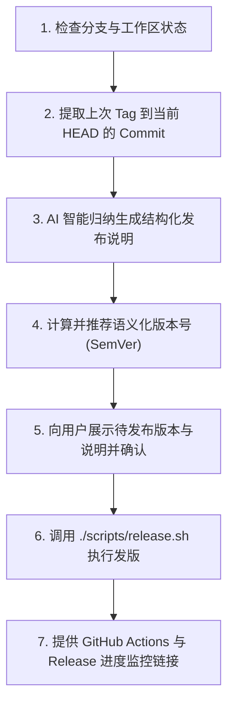

# WorkPet 自动化发版指南 (Release Skill)

本技能用于为 WorkPet 桌面端执行标准化、自动化发版。它结合 AI 智能提炼自上一版本以来的 Git 提交记录，自动生成结构清晰的中文发布说明（Release Notes），并通过项目自动化脚本 `./scripts/release.sh` 完成版本回写、Git Tag 打标推送与 GitHub Actions CI/CD 自动构建。

---

## 核心执行流程 (Workflow)



---

## 详细步骤

### 第一步：检查分支与工作区状态
1. 运行 `git status -s` 检查是否有未提交的代码变更。
   - 若存在未提交的代码变更，**优先询问用户是否需要先提交**，或调用 `commit` 技能完成提交；
   - 发版必须在工作区干净的状态下进行。
2. 运行 `git branch --show-current`，确认当前处于 `master` 或 `main` 主分支。
   - 若非主分支，向用户发出明确警告并请求确认。

### 第二步：提取提交差异并自动撰写发布说明
1. 获取当前仓库最新的 Git Tag：
   ```bash
   LATEST_TAG=$(git describe --tags --abbrev=0 2>/dev/null || echo "")
   ```
2. 查看自上个版本以来的所有 commit 记录：
   - 若存在历史 Tag：
     ```bash
     git log ${LATEST_TAG}..HEAD --pretty=format:"- %s (%h)"
     ```
   - 若无历史 Tag（首发）：
     ```bash
     git log -n 15 --pretty=format:"- %s (%h)"
     ```
3. **AI 智能整理发布说明**：
   - 过滤掉琐碎的 CI、排版微调等内部无关提交；
   - 按照 Conventional Commits 语义分类，使用结构化、面向最终用户的生动中文进行整理：
     ```markdown
     ### 🚀 新增功能 (Features)
     - 详细描述用户感知到的新特性

     ### 🐛 缺陷修复 (Bug Fixes)
     - 详细描述修复的问题与使用影响

     ### ⚡ 体验优化与底层重构 (Improvements)
     - 性能提升、UI 动效优化或系统级兼容增强
     ```

### 第三步：计算推荐版本号
遵循语义化版本规范（Semantic Versioning）：
- 若本次更新包含不兼容的架构或破坏性变动：建议递增 **Major**（如 `v1.0.0`）；
- 若本次更新包含新功能（`feat`）：建议递增 **Minor**（如 `v0.2.0`）；
- 若仅包含缺陷修复或日常维护（`fix`/`chore`/`perf`）：建议递增 **Patch**（如 `v0.1.3`）；
- 若用户在提问中已明确指定了版本号（例如“发布 v0.1.3”），直接优先使用用户指定的版本号。

### 第四步：与用户确认
向用户清晰展示：
1. **当前版本** vs **目标版本**；
2. **AI 生成的发布说明预览**。

> [!NOTE]
> 询问用户是否对发布说明有增删改调整，或是否直接执行推送。

### 第五步：调用自动化脚本发版
确认后，通过非交互参数执行项目发布脚本：
```bash
./scripts/release.sh <TARGET_TAG> -m "<RELEASE_NOTES>" -y
```
或者当发布说明较长包含多行时，写入临时文件并通过 `--notes-file` 传递：
```bash
./scripts/release.sh <TARGET_TAG> --notes-file /tmp/release_notes.txt -y
```

**脚本内部会自动执行以下动作**：
1. 校验版本号合法性与分支状态；
2. 自动更新 `pkg/version/version.go` 中的 `var Version = "..."`；
3. 自动提交版本 Bump（`chore(release): bump version to <TARGET_TAG>`）；
4. 推送主分支代码到远程 GitHub；
5. 打上带注释的附注标签 `git tag -a <TARGET_TAG> -m "..."` 并推送到远程；
6. 触发 GitHub Actions 编译多平台产物并生成携带 Ed25519 签名清单的 GitHub Release。

### 第六步：反馈发布结果
向用户展示发布成功信息，并提供实时进度跟踪链接：
- **CI 构建状态**：`https://github.com/weiwei2012holy/workpet/actions`
- **GitHub Releases**：`https://github.com/weiwei2012holy/workpet/releases`
